# 0xAB — cybersecurity research blog

A dark, terminal-native blog where I document what I learn about DevSecOps,
DevOps, application security and cloud security — and where the repository
itself is built the way I'd build anything I'm responsible for: secured CI,
pinned dependencies, and a documented deployment flow.

**Two purposes, one repo:**

1. **Writing** — technical writeups (attack walkthroughs, hardening guides,
   notes) published as Markdown files. No CMS, no database.
2. **Practice what I preach** — the CI pipeline, dependency hygiene and
   application hardening in this repo are the actual subject matter of the
   blog, applied to itself.

> Design: monospace chrome, hairline borders, near-black surfaces, a single
> terminal-green accent (`#00FF88`), engineering-grid backdrops.

**Live site:** https://your-domain.tld <!-- TODO: set after first deploy -->
**Author:** [aminebnz02-cpu](https://github.com/aminebnz02-cpu)

---

## CI/CD

Every push and pull request to `main` runs
[`.github/workflows/ci-cd-pipeline-parallel.yml`](.github/workflows/ci-cd-pipeline-parallel.yml):

```mermaid
flowchart LR
    A[push / PR / weekly cron] --> B[setup<br/>npm ci + audit signatures]
    A --> C[secrets scan<br/>Gitleaks]
    A --> D[SAST<br/>Semgrep]
    B --> E[SCA<br/>Snyk]
    B --> F[build<br/>typecheck · lint · SBOM]
    C & D & E & F --> G[ci-gate<br/>all must pass]

    style B fill:#0f1a12,stroke:#00FF88
    style G fill:#0f1a12,stroke:#00FF88
```



| Stage | Tool | What it enforces |
| --- | --- | --- |
| Dependency integrity | `npm ci` + `npm audit signatures` | Lockfile-built tree, verified tarball signatures |
| Secrets scanning | Gitleaks | No credentials in history or diffs |
| SAST | Semgrep | Static analysis on every change, re-scanned weekly against live rules |
| SCA | Snyk | No new high-severity / upgradable vulnerabilities |
| Build gate | tsc + ESLint + `next build` | Types, lint, and a working production build |
| SBOM | Syft (CycloneDX) | Machine-readable inventory of every dependency, per build |

Design decisions worth reading the workflow for:

- **Single required check (fan-in gate).** Branch protection requires only
  `ci-gate`, which asserts *all* upstream jobs succeeded (`if: always()`).
  Jobs can be renamed, split or reordered by editing the workflow — no admin
  clickpath in repo settings, and the gate logic lives in version control.
- **Everything SHA-pinned.** Every action is pinned to a commit hash, with
  minimal per-job `permissions:` and `persist-credentials: false`.
- **Pinned toolchain.** Runner image (`ubuntu-24.04`), Node, Python and
  scanner versions are exact — no silent toolchain drift under a green
  pipeline.
- **Weekly scheduled rescan.** Scanner rules and CVE feeds move even when the
  repo doesn't.
- **Deployment is delegated to Vercel's GitHub integration** — pushes to
  `main` deploy automatically once this gate passes. For a static-content
  Next.js site, a container image and registry would be ceremony, not
  security.

Planned next: SARIF uploads to GitHub Code Scanning, PR-time
`dependency-review-action`, Dependabot, and pipeline self-linting with
`zizmor`.

---

## Application security (the site itself)

The blog holds itself to the standards it writes about:

- **Strict CSP** — per-request nonce + `strict-dynamic`, no `unsafe-inline`
  for scripts; nonce stamped per request in `src/proxy.ts`
- **Hardened headers** on every response: HSTS, `X-Frame-Options: DENY`,
  `nosniff`, `Referrer-Policy`, `Permissions-Policy`, COOP, CORP
- **Render-time sanitization** — article HTML passes through a
  `sanitize-html` allowlist on every render; `data:` URIs allowed only on
  ``, links forced to `rel="noopener noreferrer nofollow"`
- **No runtime attack surface** — no database, no auth, no user input; the
  only content source is files committed to this repo, reviewed by the same
  CI gate above

---

## Stack

| Layer        | Choice                                                        |
| ------------ | ------------------------------------------------------------- |
| Framework    | **Next.js 16** (App Router, React 19, Server Components)      |
| Language     | **TypeScript** (strict)                                       |
| Styling      | **Tailwind CSS v4** + custom design tokens                    |
| UI           | shadcn-style primitives (Radix) + bespoke terminal components |
| Content      | **Flat files** — `content/articles/*.md` (gray-matter + markdown-it) |
| Highlighting | `highlight.js` (server-rendered)                              |
| Deploy       | **Vercel** (CI-gated) / any Node.js host                      |

There is **no database and no CMS**. Every article is a Markdown file
committed to the repo; the site reads them at startup and renders in memory.

**Site features:** paginated home index, article pages with sticky TOC and
server-rendered syntax highlighting, category and tag pages, ⌘K global search,
SEO with dynamic OG images, `sitemap.xml`, `robots.txt`, `llms.txt`, JSON-LD.

---

## Quick start

```bash
# 1. install
npm install --legacy-peer-deps

# 2. configure env (optional — set the deployed site's canonical URL)
cp .env.example .env.local
#    → set NEXT_PUBLIC_SITE_URL

# 3. run
npm run dev      # http://localhost:3000
```

The sample articles under `content/articles/` render immediately — nothing to
provision.

## Scripts

```bash
npm run dev        # dev server
npm run build      # production build (types + lint + prerender)
npm run start      # serve the production build
npm run lint       # eslint
npm run typecheck  # tsc --noEmit
```

---

## Writing a post

Add a Markdown file under **`content/articles/<slug>.md`** and commit it.
Publishing = merging to `main`; CI validates the build and Vercel deploys.

```md
---
title: "House of Force is dead — tcache poisoning in modern glibc"
slug: house-of-force-is-dead-tcache-poisoning
excerpt: "One-line summary shown in listings and meta tags."
category: application-security      # MUST match a slug in src/lib/site.ts
tags: [heap, glibc, tcache, pwn]
cover: /covers/house-of-force.png   # optional; a file under public/
featured: true                      # optional (default false)
published: true                     # optional (default true; false = draft)
publishedAt: 2026-08-18             # ISO date
---

## Background
...
```

Notes:

- `category` must be one of the slugs defined in `src/lib/site.ts`
  (`CATEGORIES`); everything else is free-form.
- Bodies can be Markdown or raw HTML (a body starting with `<` is passed
  through verbatim — useful for dense, hand-controlled markup). Either way it
  is sanitized + syntax-highlighted at render.
- Reading time is derived automatically (~200 wpm).

---

## Environment variables

| Variable               | Required | Notes                                           |
| ---------------------- | -------- | ----------------------------------------------- |
| `NEXT_PUBLIC_SITE_URL` | prod     | Canonical origin (OG, sitemap, canonical URLs)  |

The site builds and serves without environment variables; set the URL when
deploying so canonical links and generated metadata use the right origin.

---

## Project structure

```
content/
└─ articles/                 # one Markdown file per post (the entire "CMS")
src/
├─ app/
│  ├─ (site)/                 # public site (shares header/footer layout)
│  │  ├─ page.tsx             # homepage = paginated post index
│  │  ├─ about/               # about page
│  │  ├─ blog/[slug]/         # article page
│  │  ├─ categories/[slug]/   # category pages
│  │  └─ tags/[slug]/         # tag pages
│  ├─ api/search/route.ts     # ⌘K search endpoint
│  ├─ og/route.tsx            # dynamic OG image (next/og)
│  ├─ sitemap.ts · robots.ts · llms.txt · manifest.ts
│  ├─ layout.tsx · globals.css   # root layout, fonts, design tokens
│  └─ not-found.tsx
├─ components/
│  ├─ ui/                     # command (⌘K), dialog, sonner (toasts)
│  ├─ site/                   # header, footer, article list, search, …
│  └─ article/                # code-enhancer (copy buttons / lang labels)
├─ lib/
│  ├─ articles.ts             # loads + parses content/articles/*.md
│  ├─ queries.ts              # public data access (in-memory filters)
│  ├─ content.ts              # sanitize · highlight · TOC pipeline
│  ├─ content.types.ts        # content types
│  ├─ csp.ts · security-headers.ts   # CSP + hardening headers
│  └─ site.ts · utils.ts
└─ proxy.ts                   # security headers and CSP nonce
```

---

## Deploy

**Vercel:** import the repo, set `NEXT_PUBLIC_SITE_URL` to the production
domain, deploy. Every push to `main` deploys after the CI gate passes; every
PR gets an ephemeral preview deployment.

**Any Node.js host:** use Node.js 24, install with `npm ci
--legacy-peer-deps`, build with `npm run build`, run with `npm start`, and set
`NEXT_PUBLIC_SITE_URL` in the host's environment.

---

## License & reuse

Content (articles) is mine — reach out before republishing. Code is available
under MIT; use it, learn from it, and audit it before trusting it.
