# 0xAB — cybersecurity research blog

A dark, terminal-native blog covering DevSecOps, DevOps, application security
and cloud security. Content is Markdown committed to this repo; the CI
pipeline, dependency hygiene and app hardening in the repository are the
actual subject matter, applied to itself.

## CI/CD

Every push and pull request to `main` runs
[`.github/workflows/ci-cd-pipeline-parallel.yml`](.github/workflows/ci-cd-pipeline-parallel.yml):

```mermaid
flowchart LR
    A[push / PR / weekly cron] --> B[setup<br/>npm ci + audit signatures]
    A --> C[secrets scan<br/>Gitleaks]
    A --> D[SAST<br/>Semgrep]
    B --> E[SCA<br/>Snyk]
    B --> F[build<br/>typecheck · lint · SBOM]
    B --> G[CodeQL<br/>SAST]
    B --> H[container build<br/>Docker image + Trivy]
    A --> I[workflow audit<br/>zizmor]
    H --> J[image publish<br/>GHCR · non-PR only]
    C & D & E & F & G & H & I & J --> K[ci-gate<br/>all must pass]

    style B fill:#0f1a12,stroke:#00FF88
    style K fill:#0f1a12,stroke:#00FF88
```



| Stage | Tool | What it enforces |
| --- | --- | --- |
| Dependency integrity | `npm ci` + `npm audit signatures` | Lockfile-built tree, verified tarball signatures |
| Secrets scanning | Gitleaks | Scans full history and PR diffs for committed credentials |
| SAST | Semgrep | Static analysis on every change, re-scanned weekly against live rules |
| SAST | CodeQL | Deep dataflow analysis on the JS/TS source |
| SCA | Snyk | Production dependencies only; fails on high/critical findings with an available upgrade |
| Workflow audit | zizmor | Self-audit of this repo's Actions: injection sinks, over-privileged jobs, unpinned actions |
| Build gate | tsc + ESLint + `next build` | Types, lint, and a working production build |
| SBOM | Syft (CycloneDX) | Production dependencies only, per build |
| Container build | Docker Buildx | Production image (the repo's `Dockerfile`) built on every run, GHA-cached |
| Image scanning | Trivy | Fails the job on any HIGH/CRITICAL vulnerability in the built image; SARIF to Code Scanning |
| Image publish | GHCR | The only job with `packages: write` pushes the exact bytes Trivy scanned; skipped entirely on PRs |
| Centralized reporting | SARIF → Code Scanning | All scanner outputs land in the repo's Security tab |

Design notes:

- **Single required check (fan-in gate).** The ruleset (`.github/rulesets/main.json`)
  requires only `ci-gate`, which asserts every upstream job succeeded
  (`if: always()`). Jobs can be renamed, split or reordered by editing the
  workflow; the gate logic lives in version control, not repo settings.
- **Everything SHA-pinned.** Every action is pinned to a commit hash, with
  minimal per-job `permissions:` and `persist-credentials: false`.
- **Pinned toolchain.** Runner image (`ubuntu-24.04`), Node, Python and
  scanner versions are exact — no silent toolchain drift under a green
  pipeline.
- **Weekly scheduled rescan.** Scanner rules and CVE feeds move even when the
  repo doesn't.
- **Semgrep is intentionally non-hermetic.** `--config=auto` fetches rules
  from semgrep.dev at run time. The CLI version is pinned; the rule set is
  not, so new rules run against unchanged code on the weekly schedule. A
  green run is not reproducible by design.
- **Snyk policy.** `--fail-on=upgradable` means a known vulnerability with no
  upstream fix does not block the build. That is a documented policy choice:
  unfixable findings are tracked in Code Scanning, not used to wedge CI.
- **The image cannot bypass the scan.** `docker-image` builds and scans the
  production image holding no registry credentials; the artifact is published
  by `docker-publish` — the only job with `packages: write` — which loads and
  pushes the exact bytes Trivy gated. PR builds get build + scan with no
  publish path at all, and the `latest` tag is applied only off `main`.
- **Deployment is delegated to Vercel's GitHub integration.** Vercel deploys
  on merge to `main` — not after Actions completes. `main` is protected by
  the ruleset, which requires `ci-gate` before merging and blocks direct
  pushes, so nothing merges without a passing gate. Every PR gets an
  ephemeral preview deployment.

### Limitations

- Snyk covers production dependencies only; dev-only findings are not tracked
  by this pipeline.
- Semgrep `--config=auto` is non-hermetic: the rule set moves without a diff.
- Fork PRs do not receive `SNYK_TOKEN`, so the Snyk job fails on external
  contributions.

## Application security

- **Strict CSP** — per-request nonce + `strict-dynamic`, no `unsafe-inline`
  for scripts; nonce stamped per request in `src/proxy.ts`.
- **Hardened headers** on every response: HSTS, `X-Frame-Options: DENY`,
  `nosniff`, `Referrer-Policy`, `Permissions-Policy`, COOP, CORP.
- **Render-time sanitization** — article HTML passes through a
  `sanitize-html` allowlist on every render; `data:` URIs allowed only on
  ``, links forced to `rel="noopener noreferrer nofollow"`.
- **Minimal server surface** — no database, no auth, no user accounts. Two
  server routes accept input (search, OG image); validate inputs accordingly.
  All other content is files committed to this repo, reviewed by the CI gate.

## Security hygiene

- `SECURITY.md` with private vulnerability reporting enabled.
- Dependabot configured (`.github/dependabot.yml`).
- `CODEOWNERS` for review routing.
- Secret scanning with push protection.
- OpenSSF Scorecard badge: [](https://scorecard.dev/viewer/?uri=github.com/OWNER/REPO) — activate once the repo is public.

## Stack

| Layer        | Choice                                                        |
| ------------ | ------------------------------------------------------------- |
| Framework    | **Next.js 16** (App Router, React 19, Server Components)      |
| Language     | **TypeScript** (strict)                                       |
| Styling      | **Tailwind CSS v4** + custom design tokens                    |
| UI           | shadcn-style primitives (Radix) + bespoke terminal components |
| Content      | **Flat files** — `content/articles/*.md` (gray-matter + markdown-it) |
| Highlighting | `highlight.js` (server-rendered)                              |
| Deploy       | **Vercel** (CI-gated) / any Node.js host                      |

No database, no CMS. Every article is a Markdown file committed to the repo;
the site reads them at startup and renders in memory.

**Site features:** paginated home index, article pages with sticky TOC and
server-rendered syntax highlighting, category and tag pages, ⌘K global search,
SEO with dynamic OG images, `sitemap.xml`, `robots.txt`, `llms.txt`, JSON-LD.

## Quick start

```bash
# 1. install (--legacy-peer-deps: React 19 peer ranges conflict with some
#    transitive deps; npm ci alone fails resolution)
npm ci --legacy-peer-deps

# 2. configure env (optional — set the deployed site's canonical URL)
cp .env.example .env.local
#    → set NEXT_PUBLIC_SITE_URL

# 3. run
npm run dev      # http://localhost:3000
```

The sample articles under `content/articles/` render immediately — nothing to
provision.

## Scripts

```bash
npm run dev        # dev server
npm run build      # production build (types + lint + prerender)
npm run start      # serve the production build
npm run lint       # eslint
npm run typecheck  # tsc --noEmit
```

## Writing a post

Add a Markdown file under **`content/articles/<slug>.md`** and commit it.
Publishing = merging to `main`; CI validates the build and Vercel deploys.

```md
---
title: "House of Force is dead — tcache poisoning in modern glibc"
slug: house-of-force-is-dead-tcache-poisoning
excerpt: "One-line summary shown in listings and meta tags."
category: application-security      # MUST match a slug in src/lib/site.ts
tags: [heap, glibc, tcache, pwn]
cover: /covers/house-of-force.png   # optional; a file under public/
featured: true                      # optional (default false)
published: true                     # optional (default true; false = draft)
publishedAt: 2026-08-18             # ISO date
---

## Background
...
```

Notes:

- `category` must be one of the slugs defined in `src/lib/site.ts`
  (`CATEGORIES`); everything else is free-form.
- Bodies can be Markdown or raw HTML (a body starting with `<` is passed
  through verbatim — useful for dense, hand-controlled markup). Either way it
  is sanitized + syntax-highlighted at render.
- Reading time is derived automatically (~200 wpm).

## Environment variables

| Variable               | Required | Notes                                           |
| ---------------------- | -------- | ----------------------------------------------- |
| `NEXT_PUBLIC_SITE_URL` | prod     | Canonical origin (OG, sitemap, canonical URLs)  |

The site builds and serves without environment variables; set the URL when
deploying so canonical links and generated metadata use the right origin.

## Project structure

```
content/
└─ articles/                 # one Markdown file per post (the entire "CMS")
src/
├─ app/
│  ├─ (site)/                 # public site (shares header/footer layout)
│  │  ├─ page.tsx             # homepage = paginated post index
│  │  ├─ about/               # about page
│  │  ├─ blog/[slug]/         # article page
│  │  ├─ categories/[slug]/   # category pages
│  │  └─ tags/[slug]/         # tag pages
│  ├─ api/search/route.ts     # ⌘K search endpoint
│  ├─ og/route.tsx            # dynamic OG image (next/og)
│  ├─ sitemap.ts · robots.ts · llms.txt · manifest.ts
│  ├─ layout.tsx · globals.css   # root layout, fonts, design tokens
│  └─ not-found.tsx
├─ components/
│  ├─ ui/                     # command (⌘K), dialog, sonner (toasts)
│  ├─ site/                   # header, footer, article list, search, …
│  └─ article/                # code-enhancer (copy buttons / lang labels)
├─ lib/
│  ├─ articles.ts             # loads + parses content/articles/*.md
│  ├─ queries.ts              # public data access (in-memory filters)
│  ├─ content.ts              # sanitize · highlight · TOC pipeline
│  ├─ content.types.ts        # content types
│  ├─ csp.ts · security-headers.ts   # CSP + hardening headers
│  └─ site.ts · utils.ts
└─ proxy.ts                   # security headers and CSP nonce
```

## Deploy

**Vercel:** import the repo, set `NEXT_PUBLIC_SITE_URL` to
`https://0xab-sec.dev`, and deploy. Deploys happen on merge to `main` via the GitHub integration;
the ruleset ensures nothing merges without a passing `ci-gate`.

**Any Node.js host:** use Node.js 24, install with `npm ci
--legacy-peer-deps`, build with `npm run build`, run with `npm start`, and set
`NEXT_PUBLIC_SITE_URL` in the host's environment.

**Docker:** the repository also includes a production-oriented multi-stage
`Dockerfile`. Its Node Alpine base is pinned by tag and digest, dependencies
are installed from the lockfile, and the final image runs the standalone
server as the non-root `node` user. CI builds this image on every run, gates
it on Trivy, and publishes it to GHCR (`ghcr.io/<owner>/<repo>:sha-<sha>`,
plus `:latest` off `main`) after the scan passes. Build and run it locally
with:

```bash
docker build --tag blog0xab:local .
docker run --rm --publish 3000:3000 \
  --read-only --tmpfs /tmp:rw,noexec,nosuid,nodev \
  --cap-drop ALL --security-opt no-new-privileges \
  --env NEXT_PUBLIC_SITE_URL=http://localhost:3000 \
  blog0xab:local
```

`compose.yaml` is committed for repeatable local or single-host operation. It
applies the same runtime restrictions, health check, restart policy, and
non-root image defaults. Compose is not a production orchestrator: enterprise
deployments should promote the pinned image through a registry and enforce
resource limits, network policy, image signing/verification, and secrets
management in the target platform.

## License

Unless otherwise noted, all code, articles, and other content in this repository
are © 2026 aminebnz02-cpu. All rights reserved. No license is granted to copy,
modify, or redistribute them.
